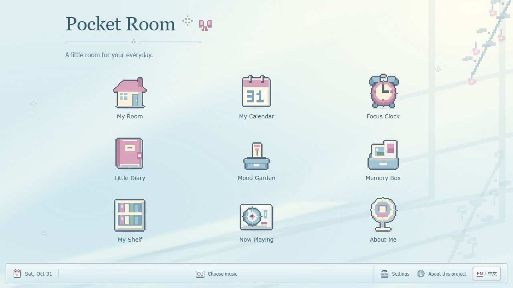
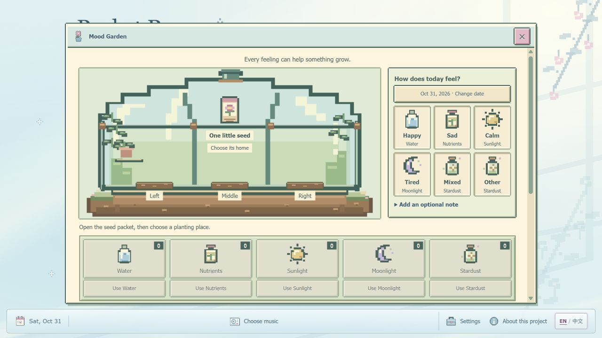
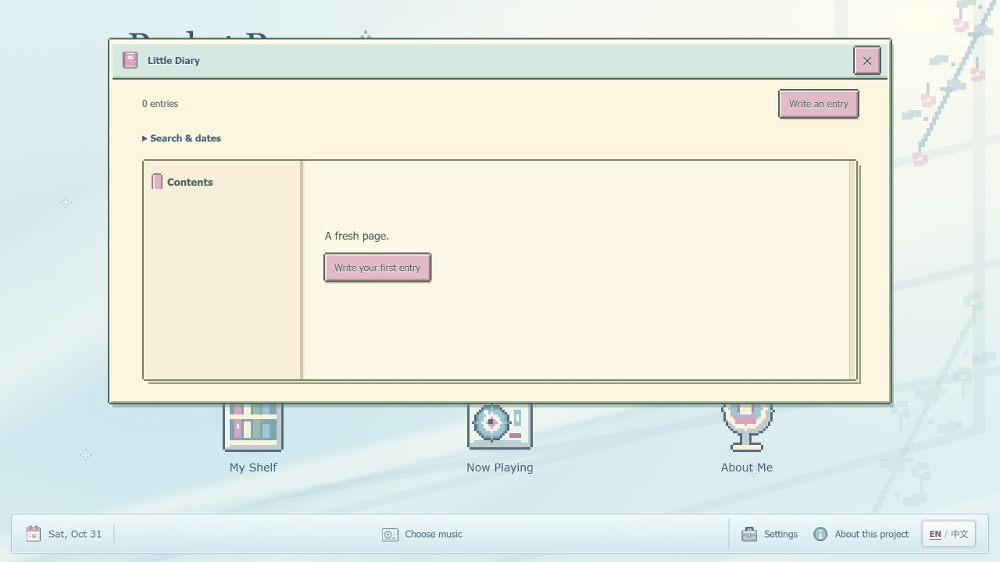

# Pocket Room

**A little room for your everyday.**

Pocket Room turns planning, journaling and little memories into a playful pixel desktop. Open a small application window from an icon, or enter the interactive bedroom and choose an object. Your content stays in your own browser, with no Pocket Room account or cloud database.

Created by **Ruoxi Zhang**, with AI-assisted development.

[Live website](https://ruoxiz03.github.io/pocket-room/) · [Source repository](https://github.com/RuoxiZ03/pocket-room)

## Screenshots

These captures show fresh, empty application states, without personal records.





## Features

| Application | Features |
| --- | --- |
| My Room | Click the computer or notebook to open Calendar or Diary, then return to the room. |
| My Calendar | Dated plans with time, categories, notes, completion and links to daily records. |
| Focus Clock | Presets/custom duration, pause/continue, completed minutes and a saved deadline that survives navigation and refresh. |
| Little Diary | Searchable dated writing, photos and optional stickers in a readable notebook. |
| Mood Garden | Symbolic mood resources, equal growth for every feeling, five care visits and a flower collection. |
| Memory Box | Multi-photo memories, full-image viewing, front/back notes and editing. |
| My Shelf | Books, films, websites and keepsakes with types, statuses, covers, notes, links and non-drag ordering. |
| Now Playing | Local audio or explicitly loaded Spotify playlists using the visible official embed. |
| About Me | User nickname, introduction, interest labels, manual Currently notes and a cropped custom avatar. |
| Backups & Settings | Complete backup/restore, legacy plan import, English/简体中文 and reduced animations. |

Windows retain browser Back/Forward and clear return paths. Mobile layouts use compact panels, with keyboard focus and reduced-motion support. About this project credits the author separately from each visitor's own profile.

## Technology

Native HTML, modular CSS and JavaScript ES modules; IndexedDB for structured content and image/audio Blobs; localStorage for small preferences and legacy recovery; SVG/code-drawn pixel art and a native canvas room renderer. Browser Audio and Spotify's official Embed handle music.

No framework, package installation, build tool or application runtime CDN is required. The included Node.js preview server has no dependencies. Spotify connects only when explicitly loaded.

## Run locally

With Node.js installed, open a terminal in this folder:

```sh
node serve.cjs 8000
```

Open **http://127.0.0.1:8000/**. Use the server rather than double-clicking index.html. Keep the same address: localhost, another port, file:// and a hosted website have separate storage.

## Local data and privacy

Records and image/audio Blobs stay in this browser's IndexedDB database `daydream-lane-world`. Uploaded files never become source files. A new visitor starts with an empty world; publishing source does not publish the creator's local records. Language and animation preferences stay in localStorage.

The historical `daydream-planner-v1` key, original plan IDs and version:1 plan backups remain compatible. Nothing automatically syncs or becomes public. Browser data can be cleared or evicted, and private browsing may be temporary.

Modules share one timer and music panel. Switching windows does not restart them; a full page reload requires manually restarting music. A closed webpage cannot guarantee a punctual focus reminder. Spotify controls playback range, availability and login requirements. No songs or remote covers are downloaded into this repository.

## Back up, restore or move devices

1. Open **Backups & Settings → Export complete world**.
2. Keep the `.daydream` file somewhere private. It includes profile, plans, diary, garden, memories, shelf, focus history, music settings and referenced photo/audio bytes.
3. On the target browser or website address, choose that file and select **Validate and import**.
4. Review the replacement summary and confirm only if you intend to replace that browser's current content. Validation precedes an atomic restore; cancellation leaves existing content unchanged.

Complete backups are **unencrypted personal files**. Never commit them, publish them with the site or include them in public screenshots. Export plans JSON includes plans only, in the compatible version:1 format.

## Project structure

```text
index.html        Desktop and shared application mounts
app.js            Routing and persistence coordination
style.css         Stylesheet imports
css/              Shared controls and component layouts
js/               Features, storage, media, timer, music and room modules
js/locales/       English and Simplified Chinese dictionaries
assets/           Bundled artwork and empty-state screenshots
serve.cjs         Local preview server
.nojekyll         Native static files on GitHub Pages
```

Change a module's layout in its matching CSS/JS files. Edit interface copy in `js/locales/en.js` and `js/locales/zh-CN.js`; change personal words inside About Me. Historical drafts, reference screenshots, test fixtures and private backups are excluded from this upload copy.

## Verification and limitations

Pre-release review passed **235 existing checks and 19 real-application integration checks**, covering CRUD, reload persistence, media backup/restore, migration, reward idempotency and timer/music continuity. Desktop/narrow Chromium viewports, both languages and keyboard window navigation were checked. See [the verification record](RELEASE-CHECK.md).

Physical iOS/Android, Safari/Firefox, screen readers, real quota exhaustion, long device sleep and Spotify playback under every account/region were not verified. There is no cloud sync, encryption, automatic backup or trash/undo. Playback does not persist across a page close. The local player keeps one saved local song; edit it to replace the audio.

## GitHub Pages

Publish this native static project from **Settings → Pages → Deploy from a branch → main → /(root)**. Keep index.html at the root and retain .nojekyll. No build command or secrets are needed. Hash routes support module navigation beneath a project-site subdirectory.

The public site is https://ruoxiz03.github.io/pocket-room/. Initial Pages deployment, all module shortcuts and 66 published resource files were verified after publication.

## Artwork and credits

Pixel components and room objects were created within this project with AI assistance. Supplied photos/cursor and historical visual references have separate permission status; see [ASSET-SOURCES.md](ASSET-SOURCES.md). No open-source license or third-party asset permission has been invented or inferred. Reference archives and private user media are not distributed here.


